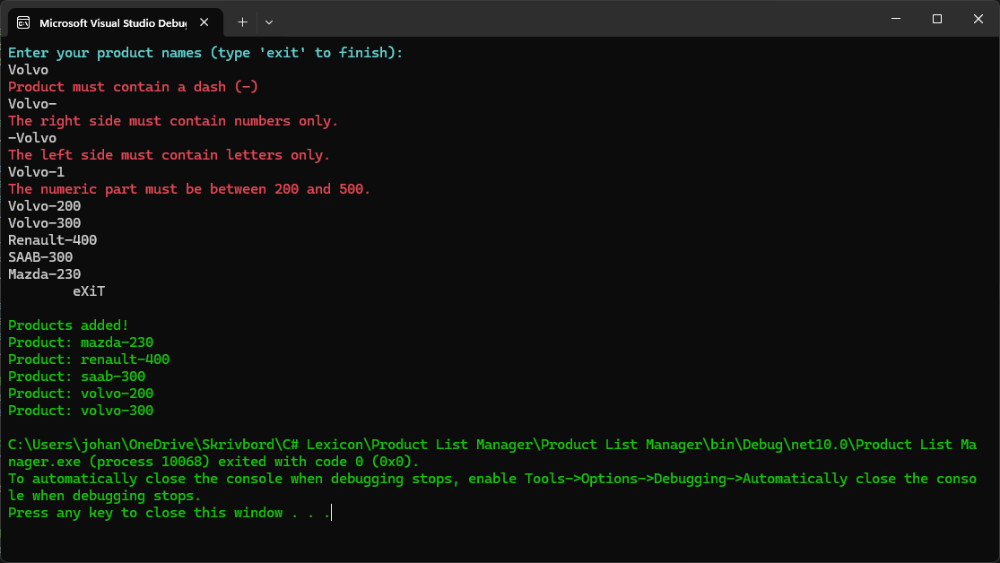

# Product List Manager

## Project Description

A C# console application. Users enter product names in the format `LETTERS-NUMBER`. The program validates each name, stores valid names in a list, and displays the sorted list when the user types `exit`.

The project practices loops, conditional statements, lists, string handling, regular expressions, input validation, and sorting.

## Features

- Runs in a loop until the user types `exit`.
- Accepts `exit` in any letter case and with leading or trailing spaces: `exit`, `EXIT`, `Exit`, `eXiT`.
- Trims spaces and converts input to lowercase.
- Rejects empty input.
- Validates the format `LETTERS-NUMBER`.
- Checks the left side with a regular expression (Regex).
- Sorts the product list alphabetically before display.
- Uses colored console output: cyan for the prompt, red for errors, green for the final result.

### Product Format

| Part | Rule |
| --- | --- |
| Left side | Letters only (A-Z), checked with the Regex `^[A-Za-z]+$` |
| Right side | Whole number from 200 to 500 |
| Separator | Exactly one dash (-) |

Valid examples: `CE-400`, `XX-480`, `LABAN-231`

Invalid examples: `CE400` (no dash), `XX3-480` (digit on the left side), `LABAN-100` (number below 200)

Valid names are stored in lowercase. `CE-400` is stored as `ce-400`.

### Validation Messages

| Input problem | Message |
| --- | --- |
| Empty input | Input cannot be empty. |
| Missing dash or more than one dash | Product must contain a dash (-) |
| Left side has non-letter characters | The left side must contain letters only. |
| Right side is not a number | The right side must contain numbers only. |
| Number below 200 or above 500 | The numeric part must be between 200 and 500. |

After an error, the program asks for the next product. Invalid input is not stored.

## Technologies

- C# (.NET 8/9/10)
- Console Application
- Regular expressions (`System.Text.RegularExpressions`)
- Visual Studio or VS Code

## Installation

1. Install the .NET SDK, version 8 or later.
2. Clone the repository:

```
git clone <repository-url>
```

3. Open the project folder:

```
cd <project-folder>
```

## How to Run

Run the application from the terminal:

```
dotnet run
```

In Visual Studio, press F5 or select Start.

Example session:

```
Enter your product names (type 'exit' to finish):
LABAN-231
CE400
Product must contain a dash (-)
xx3-480
The left side must contain letters only.
ce-abc
The right side must contain numbers only.
ce-100
The numeric part must be between 200 and 500.
CE-400
  EXIT

Products added!
Product: ce-400
Product: laban-231
```

## Screenshots



## Team Members

| Name | GitHub |
| --- | --- |
| Your Name | [@your-username](https://github.com/lorriluring) |

## Future Improvements

- Move the existing validation checks into separate methods.
- Replace the Split and TryParse checks with one regular expression.
